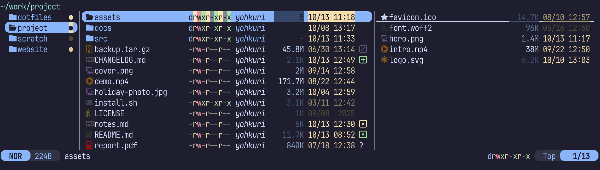

# supaline.yazi

[Yazi](https://github.com/sxyazi/yazi) shows one linemode at a time — size, or
mtime, or permissions. supaline is a plugin that turns it into as many columns
as you like, in any order, at any width, each styled its own way.



It is drawn from [My favourite setup](#my-favourite-setup), and
[the examples](docs/examples/README.md) show more, each with the configuration
that draws it.

- **Columns side by side** — size, timestamps, permissions, owner and more,
  in the order you list them.
- **Styles** — colour, bold, italic, underline and the rest, per column. A
  colour can be a gradient from the smallest value in the folder to the
  largest. Set it in `init.lua` or in your `theme.toml`.
- **One key to show and hide** — Yazi's own `linemode` switches and never
  back; `toggle` brings the columns up and puts them away again, and can do
  the same for another plugin's sign, such as git.yazi's.
- **Columns of your own** — a few lines of Lua, through the interface the
  built-in columns use.
- **Different columns per pane** — the parent and preview panes can show
  columns too.

## Requirements

Yazi **26.9.1**. Older releases refuse to load the plugin, and newer ones are
untested: Yazi changes its plugin API between releases.

## Installation

```sh
ya pkg add yohkuri/supaline
```

## Quick start

```lua
-- ~/.config/yazi/init.lua
require("supaline"):setup {
  linemodes = {
    detail = { "size", "mtime" },
  },
}
```

```toml
# ~/.config/yazi/yazi.toml
[mgr]
linemode = "detail"
```

Each key of `linemodes` becomes a linemode of its own. To show and hide it
from a key:

```toml
# ~/.config/yazi/keymap.toml
[[mgr.prepend_keymap]]
on   = [ "m", "d" ]
run  = "plugin supaline -- toggle detail"
desc = "Toggle supaline's columns"
```

## Built-in columns

| Column        | Shows                          |
| ------------- | ------------------------------ |
| `size`        | File size; for a directory Yazi has listed but not sized, its entry count |
| `mtime`       | Modified time                  |
| `btime`       | Created time                   |
| `atime`       | Accessed time                  |
| `permissions` | `drwxr-xr-x`, coloured from your theme |
| `owner`       | `user:group`                   |
| `user`        | Owning user                    |
| `group`       | Owning group                   |
| `count`       | Entry count, directories only  |

Any column takes options beside its name:

```lua
detail = {
  "permissions",
  { "size", width = 9 },
  { "mtime", format = "%Y-%m-%d" },
}
```

## Styles

```lua
detail = {
  { "size",  style = "#0b3d91 -> #7fd4ff" },             -- a gradient
  { "mtime", style = { fg = "green", italic = true } },  -- a colour, in italics
  { "owner", style = { bold = true } },                  -- bold, nothing else
}
```

Or in your theme, so a flavor can ship them:

```toml
# ~/.config/yazi/theme.toml
[supaline]
size  = "#0b3d91 -> #7fd4ff"
mtime = { fg = "green", italic = true }
```

A style table takes `fg` and `bg`, plus `bold`, `dim`, `italic`, `underline`,
`blink`, `blink_rapid`, `reversed`, `hidden` and `crossed`, spelled the same in
both files. One thing differs: in `theme.toml` a gradient is a whole value, as
`size` is above. Under a table's `fg` Yazi reads it as one colour, fails to
parse it, and drops the whole file.

A gradient runs from the smallest value in the folder being shown to the
largest, so the biggest file there always lands on the last colour.
[Styles](docs/styles.md) also covers spreading a single colour across a
lightness range, and separators.

## Your own column

```lua
local supaline = require("supaline")

supaline.column("ext", {
  width  = 6,
  align  = "left",
  render = function(file, ctx) return file.url.ext or "", ctx.style end,
})

supaline:setup {
  linemodes = { detail = { "ext", "size", "mtime" } },
}
```

[Writing a column](docs/columns.md) covers per-folder statistics, gradients
and options of your own.

## My favourite setup

The picture at the top, in Ghostty on the
[Catppuccin Mocha](https://github.com/yazi-rs/flavors) flavor, with
[git.yazi](https://github.com/yazi-rs/plugins/tree/main/git.yazi) beside
supaline. git.yazi's signs and the file icons are Nerd Font glyphs. Each of
`size` and `mtime` is one colour spread across a lightness range, and so is
`mark`, a column of your own in the parent pane:

```lua
-- ~/.config/yazi/init.lua
local supaline = require("supaline")

local function mtime(file) return file.cha.mtime or 0 end

supaline.column("mark", {
  width = 1,
  style = "#3b82f6 <->",
  stats = supaline.extremes(mtime),
  render = function(file, ctx)
    return "●", ctx.style_at(ctx.ratio(mtime(file)))
  end,
})

require("git"):setup { order = 1500 }
supaline:setup {
  lightness = { fg = { from = 0.40, to = 0.90 } },
  linemodes = {
    detail = {
      current = {
        "permissions",
        { "user", style = { italic = true } },
        { "size", style = "#ef4444 <->" },
        { "mtime", style = "#3b82f6 <->" },
      },
      parent  = { "mark" },
      preview = {
        { "size", style = "#ef4444 <->" },
        { "mtime", style = "#3b82f6 <->" },
      },
    },
  },
  toggles = { git = 1500 },
}
```

```toml
# ~/.config/yazi/yazi.toml
[mgr]
linemode = "detail"

[[plugin.prepend_fetchers]]
url   = "*"
run   = "git"
group = "git"

[[plugin.prepend_fetchers]]
url   = "*/"
run   = "git"
group = "git"
```

```toml
# ~/.config/yazi/theme.toml
[git]
clean_sign   = "  "
unknown_sign = "  "
```

```toml
# ~/.config/yazi/keymap.toml
[[mgr.prepend_keymap]]
on   = [ "m", "d" ]
run  = "plugin supaline -- toggle detail"
desc = "Toggle supaline's columns"

[[mgr.prepend_keymap]]
on   = [ "m", "g" ]
run  = "plugin supaline -- toggle git"
desc = "Toggle git.yazi's sign"
```

`m d` shows and hides the columns, and `m g` git.yazi's sign, which `toggles`
names by the `order` it was added at. The two signs in `theme.toml` keep the
columns lined up on the rows git.yazi has nothing to say about.

## Documentation

- [Examples](docs/examples/README.md) — a picture of each, beside the
  configuration that draws it
- [Configuration](docs/configuration.md) — every option, per-pane columns,
  toggling, the built-in columns in detail, using it alongside git.yazi, and
  the caveats
- [Styles](docs/styles.md) — colours, attributes, gradients, lightness
  ranges and the theme
- [Writing a column](docs/columns.md) — the column interface

## Contributing

Bug reports and pull requests are welcome; see
[CONTRIBUTING.md](CONTRIBUTING.md).

## License

MIT
