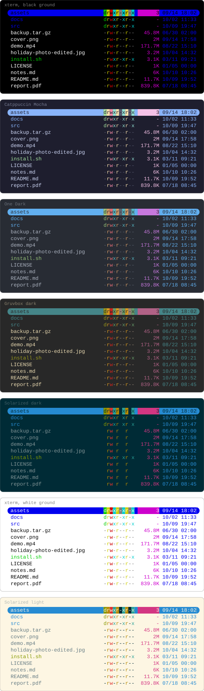
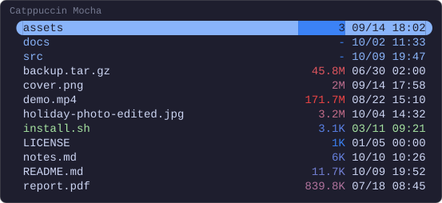
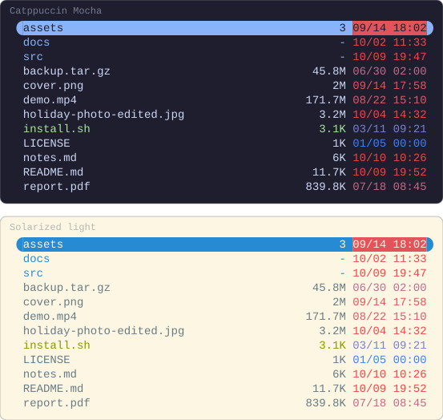

# Colours

What a column can be coloured with: a colour your terminal names, and a
gradient from the smallest value in the folder to the largest. How the pictures
are drawn is in [the index](README.md).

## On any terminal

A colour written by name — `blue`, `magenta` — is drawn from your terminal's
own palette, the same way Yazi draws a directory or an executable. One capture
of this configuration, drawn in the colours of seven terminal schemes:

```lua
-- ~/.config/yazi/init.lua
require("supaline"):setup {
  linemodes = {
    detail = {
      "permissions",
      { "size", style = "magenta" },
      { "mtime", style = "blue" },
    },
  },
}
```

<!-- drawn on every ground -->


`permissions` takes its colours from your theme's `[status]` section, and
Yazi's preset theme writes those by name as well.

Every way to write a colour is under [`style`](../styles.md#style), and what
`permissions` draws under [Built-in columns](../configuration.md#built-in-columns).

## A gradient on size

A colour can run from the smallest value in the folder to the largest. From
blue to red, the small files are cool and the large ones hot.
`size` places a file by the magnitude of its size, so kilobytes and gigabytes
in one folder still spread across the whole gradient; a directory, which has
no size to place, takes the low end.

```lua
-- ~/.config/yazi/init.lua
require("supaline"):setup {
  linemodes = {
    detail = {
      { "size", style = "#3b82f6 -> #ef4444" },
      "mtime",
    },
  },
}
```



How a gradient is written and where a file lands on it are under
[A gradient](../styles.md#a-gradient), and placing by magnitude under
[`scale`](../styles.md#scale).

## A gradient on age

The same on `mtime` draws what changed recently hot, and what has sat
untouched for months cool.

```lua
-- ~/.config/yazi/init.lua
require("supaline"):setup {
  linemodes = {
    detail = {
      "size",
      { "mtime", style = "#3b82f6 -> #ef4444" },
    },
  },
}
```



A timestamp is placed on a linear scale rather than by magnitude;
[`scale`](../styles.md#scale) says why.
