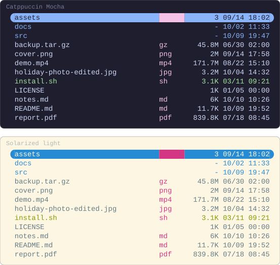
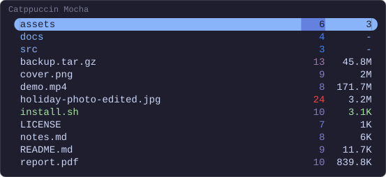
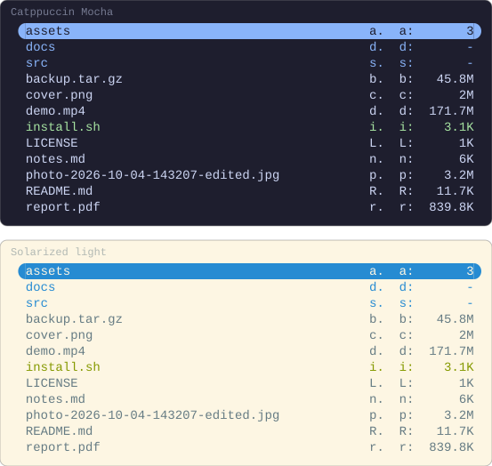

# Columns of your own

A column you write goes through the same interface as the built-in ones, and
is used by name the same way. How the pictures are drawn is in
[the index](README.md).

## A file's extension

A column is registered before `setup`, with a `render` that returns what a row
draws and the style to draw it in:

```lua
-- ~/.config/yazi/init.lua
local supaline = require("supaline")

supaline.column("ext", {
  width = 6,
  align = "left",
  style = "magenta",
  render = function(file, ctx) return file.url.ext or "", ctx.style end,
})

supaline:setup {
  linemodes = {
    detail = { "ext", "size", "mtime" },
  },
}
```



A directory has no extension, and nor has `LICENSE`, so both draw an empty
cell; `backup.tar.gz` has `gz`, the part after the last dot.

> [!IMPORTANT]
> `render` runs for every visible row on every frame. Keep it to a lookup, and
> leave anything that has to look at the whole folder to `stats`.

What `render` is handed and may return is under
[Writing a column](../columns.md) and [`ctx`](../columns.md#ctx).

## A gradient of your own

A gradient needs the smallest and largest value in the folder, which `stats`
measures once for every row, and `supaline.extremes` is that loop. Here the
length of each file's name, from blue to red:

```lua
-- ~/.config/yazi/init.lua
local supaline = require("supaline")

local function name_length(file) return #file.name end

supaline.column("namelen", {
  width = 4,
  style = "#3b82f6 -> #ef4444",
  stats = supaline.extremes(name_length),
  render = function(file, ctx)
    local n = name_length(file)
    return tostring(n), ctx.style_at(ctx.ratio(n))
  end,
})

supaline:setup {
  linemodes = {
    detail = { "namelen", "size" },
  },
}
```



`ctx.ratio` places a value between the extremes, and `ctx.style_at` turns
that place into a step of the gradient.

> [!WARNING]
> A `stats` of your own has to return `{ min = ..., max = ... }`, by name. A
> list such as `{ lo, hi }` leaves both unset, and the column draws flat at
> its gradient's low end, with a notification on screen saying why.

What `stats` has to return, and how often it runs, is under
[A column on a gradient](../columns.md#a-column-on-a-gradient).

## Options of its own

A column may take options of its own, read off `ctx.opts`. Naming them in
`options` is what lets a misspelling be refused, and a default may sit on the
definition, overridden where the column is used:

```lua
-- ~/.config/yazi/init.lua
local supaline = require("supaline")

supaline.column("initials", {
  width = 3,
  options = { "between" },
  between = ".",
  render = function(file, ctx)
    return file.name:sub(1, 1) .. ctx.opts.between, ctx.style
  end,
})

supaline:setup {
  linemodes = {
    detail = {
      "initials",
      { "initials", between = ":" },
      "size",
    },
  },
}
```



> [!NOTE]
> An option may not share a name with a key every column takes, which is why
> this one is `between` rather than `separator`.

Checking an option's value while `setup` runs, rather than at the first row,
is under [Options of its own](../columns.md#options-of-its-own).
