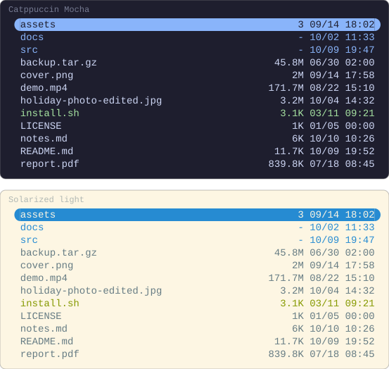
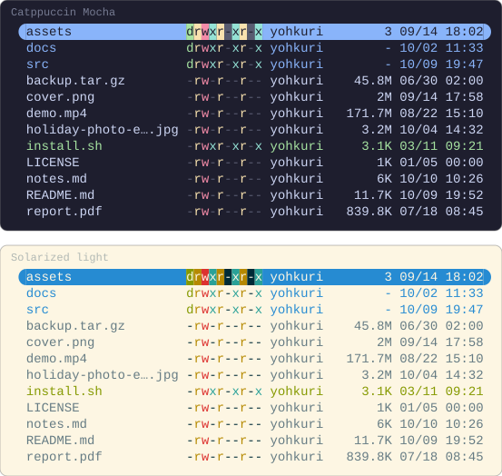
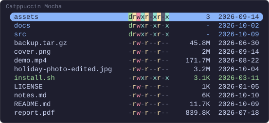
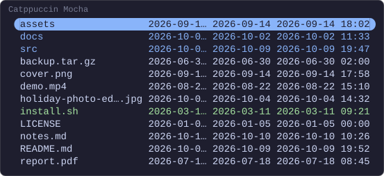
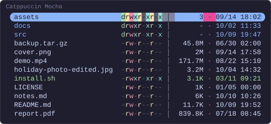

# Layout

Which columns a linemode draws, how wide each is, and what goes between them.
How the pictures are drawn is in [the index](README.md).

## Quick start

Two columns, in the order they are listed, flush against the right edge of the
pane:

```lua
-- ~/.config/yazi/init.lua
require("supaline"):setup {
  linemodes = {
    detail = { "size", "mtime" },
  },
}
```



Each key of `linemodes` becomes a linemode of its own, which `yazi.toml` or a
key switches to. A directory has no size of its own: `size` counts its entries
once Yazi has listed it, as it has the hovered one here, and draws a dash
until then.

The rest of the setup, the `yazi.toml` line and a key to show and hide the
columns, is under [Quick start](../README.md#quick-start), and every option
`setup` takes under [`setup` options](../configuration.md#setup-options).

## Like `ls -l`

Four of the built-in columns give the long listing `ls -l` prints:

```lua
-- ~/.config/yazi/init.lua
require("supaline"):setup {
  linemodes = {
    detail = { "permissions", "owner", "size", "mtime" },
  },
}
```



Yazi gives the columns their room first, so a long file name is cut short
rather than a column. `owner` is the user and group from this machine's
accounts, which `user` and `group` show one at a time.

Every built-in column, with its width, is under
[Built-in columns](../configuration.md#built-in-columns).

## Column options

A column takes options beside its name: `width` in cells, and `format`, which
the timestamp columns hand to `os.date`.

```lua
-- ~/.config/yazi/init.lua
require("supaline"):setup {
  linemodes = {
    detail = {
      "permissions",
      { "size", width = 9 },
      { "mtime", format = "%Y-%m-%d" },
    },
  },
}
```



Every option a column takes, `align` and `max_width` among them, is under
[Column specs](../configuration.md#column-specs).

## When a cell does not fit

A cell wider than its column is cut short, so it never takes room from the
file name. `overflow` says how: with an ellipsis, which is the default, cut
off at the edge, or not at all. One timestamp, too long for its 10 cells,
three ways:

```lua
-- ~/.config/yazi/init.lua
require("supaline"):setup {
  linemodes = {
    detail = {
      { "mtime", format = "%Y-%m-%d %H:%M", width = 10 },
      { "mtime", format = "%Y-%m-%d %H:%M", width = 10, overflow = "clip" },
      { "mtime", format = "%Y-%m-%d %H:%M", width = 10, overflow = "grow" },
    },
  },
}
```



`grow` draws the whole cell, and the name pays for it.

`overflow` is under [Column specs](../configuration.md#column-specs), and how
a cell is cut under [Caveats](../configuration.md#caveats).

## Separators

A separator is drawn between two columns, a space unless you say otherwise. A
table gives it a colour, and a column can carry one of its own:

```lua
-- ~/.config/yazi/init.lua
require("supaline"):setup {
  separator = { " │ ", style = "#7f849c" },
  linemodes = {
    detail = {
      "permissions",
      "size",
      { "mtime", separator = { " · ", style = "#ec4899" } },
    },
  },
}
```



A separator written on a column replaces the plugin-wide one whole, colour and
all.

Where a separator may be written, and what it may not carry, is under
[A coloured separator](../styles.md#a-coloured-separator).
