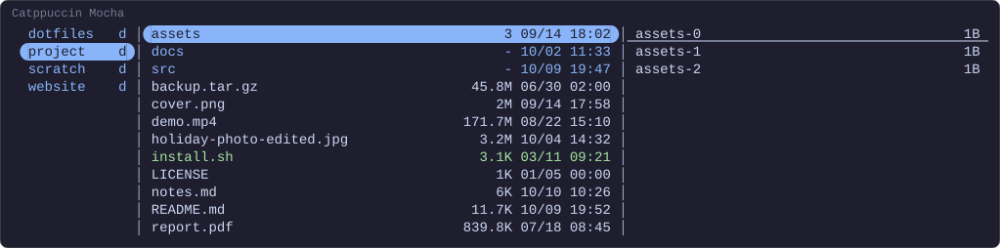
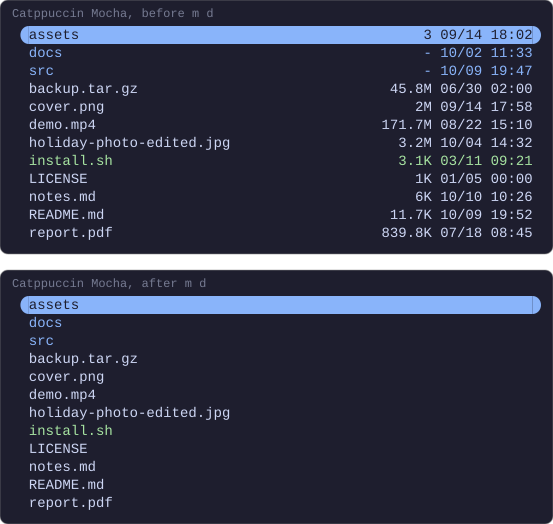
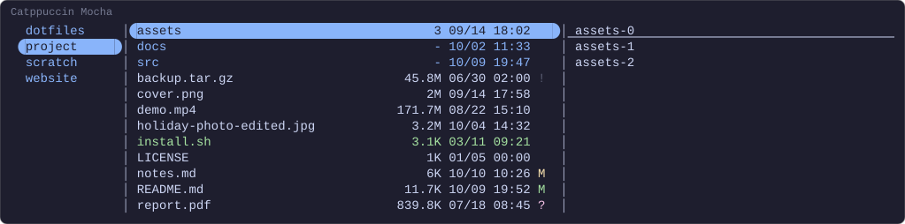
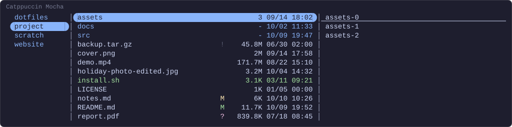
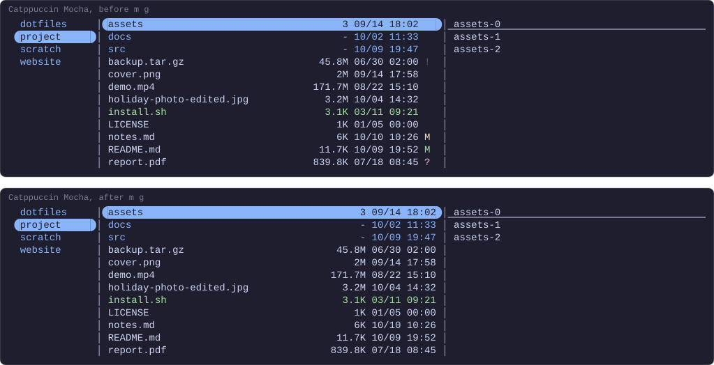

# Panes and keys

The columns in the parent and preview panes beside the file list, a key that
shows them and hides them, and supaline beside git.yazi's sign. How the
pictures are drawn is in [the index](README.md).

## Different columns per pane

A linemode that names a pane draws columns there, and a pane it leaves out
draws none. Under Yazi's own `ratio` the parent pane is an eighth of the
terminal, 15 cells at the 120 columns drawn here and 21 at 170. Four of them
are a margin, the two ends of the hovered row and the space before the
columns, a file icon takes two more where Yazi draws one, and what the columns
take comes out of the names. Here the parent pane has a column of your own, a
dot for when each entry was last modified, one colour spread across a
lightness range the way
[a built-in can be](styles.md#one-colour-across-a-lightness-range): the most
recent is the lightest. The preview pane shows the hovered directory with the
sizes in it:

```lua
-- ~/.config/yazi/init.lua
local supaline = require("supaline")

local function mtime(file) return file.cha.mtime or 0 end

supaline.column("mark", {
  width = 1,
  style = "#ef4444 <->",
  stats = supaline.extremes(mtime),
  render = function(file, ctx)
    return "●", ctx.style_at(ctx.ratio(mtime(file)))
  end,
})

supaline:setup {
  lightness = { fg = { from = 0.40, to = 0.90 } },
  linemodes = {
    detail = {
      current = { "size", "mtime" },
      parent  = { "mark" },
      preview = { "size" },
    },
  },
}
```

```toml
# ~/.config/yazi/yazi.toml
[mgr]
linemode = "detail"
```

<!-- drawn 120 columns wide -->


## A key that shows the columns and hides them

`plugin supaline -- toggle` switches to a linemode, or back to `none` when it
is the one showing, so one key does both:

```lua
-- ~/.config/yazi/init.lua
require("supaline"):setup {
  linemodes = {
    detail = { "size", "mtime" },
  },
}
```

```toml
# ~/.config/yazi/keymap.toml
[[mgr.prepend_keymap]]
on   = [ "m", "d" ]
run  = "plugin supaline -- toggle detail"
desc = "Toggle supaline's columns"
```

<!-- drawn before and after pressing m d -->


## Alongside git.yazi

[git.yazi](https://github.com/yazi-rs/plugins/tree/main/git.yazi) draws a
file's git status as a sign of its own, to the right of supaline's columns. Its
signs are Nerd Font glyphs by default, which these pictures cannot draw, so the
`theme.toml` below gives them git's own letters. A clean file has no sign, so on
every row with one the columns are pushed left by its width:

```lua
-- ~/.config/yazi/init.lua
require("git"):setup { order = 1500 }
require("supaline"):setup {
  linemodes = {
    detail = { "size", "mtime" },
  },
}
```

```toml
# ~/.config/yazi/yazi.toml
[mgr]
linemode = "detail"

[[plugin.prepend_fetchers]]
url   = "*"
run   = "git"
group = "git"

[[plugin.prepend_fetchers]]
url   = "*/"
run   = "git"
group = "git"
```

```toml
# ~/.config/yazi/theme.toml
[git]
unstaged_sign = "M "
staged_sign   = "M "
ignored_sign  = "! "
```

<!-- drawn 120 columns wide -->


Giving the clean rows a sign as wide as the rest, two spaces, lines the columns
up again with the signs at the right edge. `unknown_sign` is the one for a
file git.yazi has no status for yet, or none at all outside a repository, so
the columns stay put there too:

```lua
-- ~/.config/yazi/init.lua
require("git"):setup { order = 1500 }
require("supaline"):setup {
  linemodes = {
    detail = { "size", "mtime" },
  },
}
```

```toml
# ~/.config/yazi/yazi.toml
[mgr]
linemode = "detail"

[[plugin.prepend_fetchers]]
url   = "*"
run   = "git"
group = "git"

[[plugin.prepend_fetchers]]
url   = "*/"
run   = "git"
group = "git"
```

```toml
# ~/.config/yazi/theme.toml
[git]
unstaged_sign = "M "
staged_sign   = "M "
ignored_sign  = "! "
clean_sign    = "  "
unknown_sign  = "  "
```

<!-- drawn 120 columns wide -->


Or an `order` below supaline's puts the sign before the columns, which stay
flush right:

```lua
-- ~/.config/yazi/init.lua
require("git"):setup { order = 500 }
require("supaline"):setup {
  linemodes = {
    detail = { "size", "mtime" },
  },
}
```

```toml
# ~/.config/yazi/yazi.toml
[mgr]
linemode = "detail"

[[plugin.prepend_fetchers]]
url   = "*"
run   = "git"
group = "git"

[[plugin.prepend_fetchers]]
url   = "*/"
run   = "git"
group = "git"
```

```toml
# ~/.config/yazi/theme.toml
[git]
unstaged_sign = "M "
staged_sign   = "M "
ignored_sign  = "! "
```

<!-- drawn 120 columns wide -->


Both are under [Alongside git.yazi](../configuration.md#alongside-gityazi).

## A key for git.yazi's sign

`toggle` hides the sign as well, given a name for it under `toggles` and the
`order` git.yazi added it at. The columns stay, as the sign does under `m d`,
and move right into the room the sign took:

```lua
-- ~/.config/yazi/init.lua
require("git"):setup { order = 1500 }
require("supaline"):setup {
  linemodes = {
    detail = { "size", "mtime" },
  },
  toggles   = { git = 1500 },
}
```

```toml
# ~/.config/yazi/yazi.toml
[mgr]
linemode = "detail"

[[plugin.prepend_fetchers]]
url   = "*"
run   = "git"
group = "git"

[[plugin.prepend_fetchers]]
url   = "*/"
run   = "git"
group = "git"
```

```toml
# ~/.config/yazi/theme.toml
[git]
unstaged_sign = "M "
staged_sign   = "M "
ignored_sign  = "! "
clean_sign    = "  "
unknown_sign  = "  "
```

```toml
# ~/.config/yazi/keymap.toml
[[mgr.prepend_keymap]]
on   = [ "m", "g" ]
run  = "plugin supaline -- toggle git"
desc = "Toggle git.yazi's sign"
```

<!-- drawn 120 columns wide -->
<!-- drawn before and after pressing m g -->


Why it takes an `order` rather than the plugin's name is under
[Toggling from a key](../configuration.md#toggling-from-a-key).
