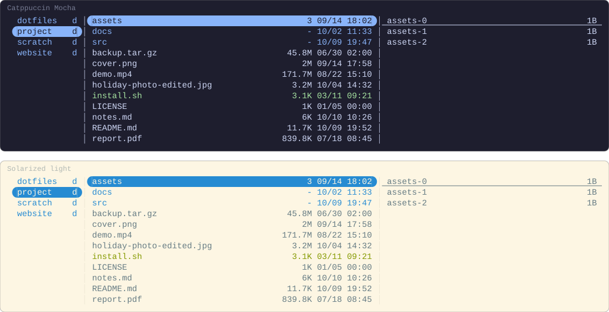
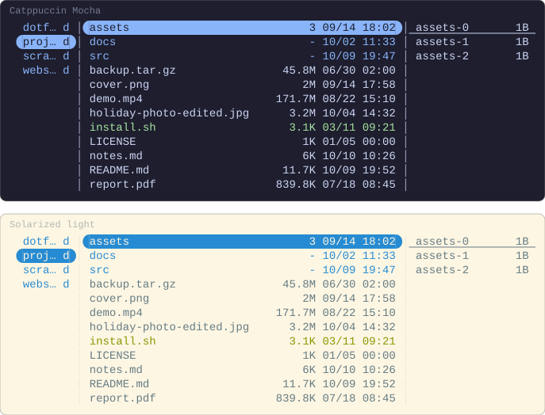

# Panes and keys

The columns in the parent and preview panes beside the file list, a key that
shows them and hides them, and supaline beside git.yazi's sign. How the
pictures are drawn is in [the index](README.md).

## Different columns per pane

A linemode that names a pane draws columns there, and a pane it leaves out
draws none. The parent pane is narrow, so it gets a one-cell column of your
own, and the preview pane shows the hovered directory with the sizes in it:

```lua
-- ~/.config/yazi/init.lua
local supaline = require("supaline")

supaline.column("mark", {
  width = 1,
  render = function(file, ctx)
    return file.cha.is_dir and "d" or "f", ctx.style
  end,
})

supaline:setup {
  linemodes = {
    detail = {
      current = { "size", "mtime" },
      parent  = { "mark" },
      preview = { "size" },
    },
  },
}
```

At 120 columns, under Yazi's own `ratio`:

```toml
# ~/.config/yazi/yazi.toml
[mgr]
linemode = "detail"
```

<!-- drawn 120 columns wide -->


At 80 columns, with the panes either side narrowed:

```lua
-- ~/.config/yazi/init.lua
local supaline = require("supaline")

supaline.column("mark", {
  width = 1,
  render = function(file, ctx)
    return file.cha.is_dir and "d" or "f", ctx.style
  end,
})

supaline:setup {
  linemodes = {
    detail = {
      current = { "size", "mtime" },
      parent  = { "mark" },
      preview = { "size" },
    },
  },
}
```

```toml
# ~/.config/yazi/yazi.toml
[mgr]
linemode = "detail"
ratio    = [1, 5, 2]
```

<!-- drawn 80 columns wide -->


## A key that shows the columns and hides them

`plugin supaline -- toggle` switches to a linemode, or back to `none` when it
is the one showing, so one key does both:

```lua
-- ~/.config/yazi/init.lua
require("supaline"):setup {
  linemodes = {
    detail = { "size", "mtime" },
  },
}
```

```toml
# ~/.config/yazi/keymap.toml
[[mgr.prepend_keymap]]
on   = [ "m", "d" ]
run  = "plugin supaline -- toggle detail"
desc = "Toggle supaline's columns"
```

<!-- drawn before and after pressing m d -->

