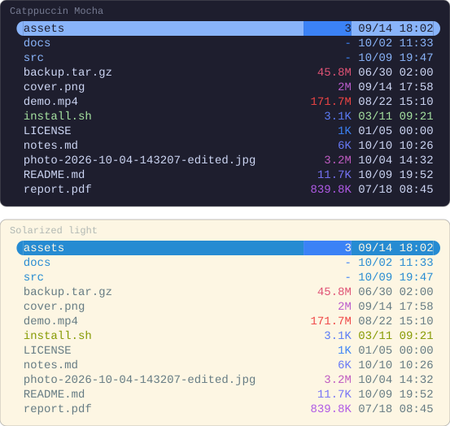
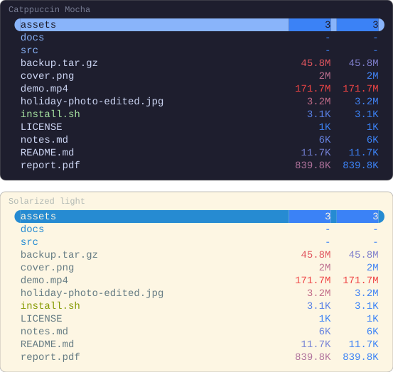
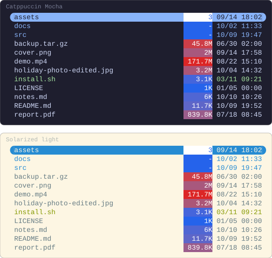
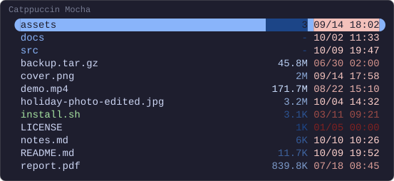
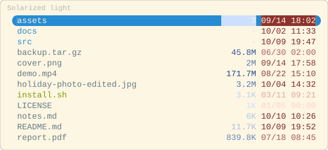
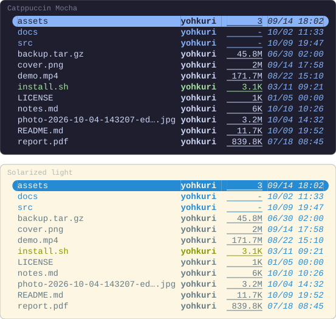
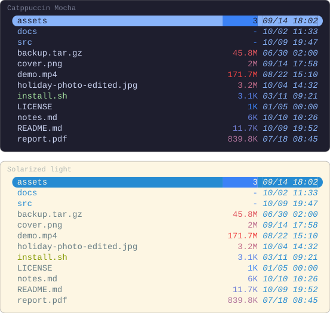
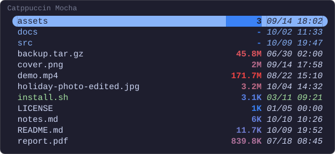
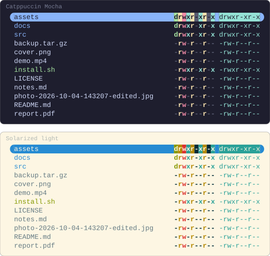

# Styles

What a column is drawn in: a colour your terminal names, a gradient from the
smallest value in the folder to the largest, one colour across a lightness
range, and the attributes a terminal draws, such as bold and underline —
written in `init.lua`, in `theme.toml`, or in both. How the pictures are drawn
is in [the index](README.md).

## Named colours

A colour written by name — `blue`, `magenta` — is whatever your terminal's
colour scheme makes it, the same way Yazi draws a directory or an executable.
One capture of this configuration, drawn in the colours of five schemes and of
xterm's own palette, on black and on white:

```lua
-- ~/.config/yazi/init.lua
require("supaline"):setup {
  linemodes = {
    detail = {
      "permissions",
      { "size", style = "magenta" },
      { "mtime", style = "blue" },
    },
  },
}
```

<!-- drawn on every ground -->


`permissions` takes its colours from your Yazi theme's `[status]` section,
and Yazi's preset theme writes those by name as well.

> [!TIP]
> A named colour suits a configuration you share, or one you keep across
> colour schemes: it follows the scheme rather than fighting it. A `#rrggbb`
> looks the same on every scheme.

Every way to write a colour is under [`style`](../styles.md#style), and what
`permissions` draws under [Built-in columns](../configuration.md#built-in-columns).

## A gradient on size

A colour can run from the smallest value in the folder to the largest. From
blue to red, the small files are cool and the large ones hot.
`size` places a file by the magnitude of its size, so kilobytes and gigabytes
in one folder still spread across the whole gradient; a directory, which has
no size to place, takes the low end.

```lua
-- ~/.config/yazi/init.lua
require("supaline"):setup {
  linemodes = {
    detail = {
      { "size", style = "#3b82f6 -> #ef4444" },
      "mtime",
    },
  },
}
```


> [!IMPORTANT]
> A gradient's stops have to be `#rrggbb`. A named colour is whatever the
> terminal makes it, and a gradient between two guesses would meet neither.

How a gradient is written and where a file lands on it are under
[A gradient](../styles.md#a-gradient), and placing by magnitude under
[`scale`](../styles.md#scale).

## A gradient on age

The same on `mtime` draws what changed recently hot, and what has sat
untouched for months cool.

```lua
-- ~/.config/yazi/init.lua
require("supaline"):setup {
  linemodes = {
    detail = {
      "size",
      { "mtime", style = "#3b82f6 -> #ef4444" },
    },
  },
}
```


A timestamp is placed on a linear scale rather than by magnitude;
[`scale`](../styles.md#scale) says why.

## Three stops

Between two stops, a file in the middle of the range takes the colour halfway
along the line between them, and for blue and red that is a muted purple, duller
than either end. A third stop says what the middle is instead. The same
column twice, the second through a neutral grey, so the middling files fade
and only the smallest and the largest stand out in colour:

```lua
-- ~/.config/yazi/init.lua
require("supaline"):setup {
  linemodes = {
    detail = {
      { "size", style = "#3b82f6 -> #ef4444" },
      { "size", style = "#3b82f6 -> #808080 -> #ef4444" },
    },
  },
}
```



The stops are spread evenly, so the middle one is drawn at the middle of the
range; see [A gradient](../styles.md#a-gradient).

## Log against linear

Placed by the size itself rather than its magnitude, on a linear scale, the
largest file takes the top of the gradient and almost everything else lands
near the bottom. The same column twice, the second linear:

```lua
-- ~/.config/yazi/init.lua
require("supaline"):setup {
  linemodes = {
    detail = {
      { "size", style = "#3b82f6 -> #ef4444" },
      { "size", style = "#3b82f6 -> #ef4444", scale = "linear" },
    },
  },
}
```



> [!NOTE]
> `size` is the one built-in column on a log scale by default, and
> `scale = "linear"` in `setup` reaches it too.

Where `scale` may be written, and which place wins, is under
[`scale`](../styles.md#scale).

## A gradient behind the text

A gradient under `bg` colours the cell rather than the text, and an `fg`
beside it is drawn on every step.

```lua
-- ~/.config/yazi/init.lua
require("supaline"):setup {
  linemodes = {
    detail = {
      { "size", style = { bg = "#2563eb -> #dc2626", fg = "#ffffff" } },
      "mtime",
    },
  },
}
```



> [!TIP]
> Pick the background for the text drawn on it. These two are darker than the
> blue and red above, so white reads on both ends.

`fg` and `bg` both take a gradient, together or apart; see
[A gradient](../styles.md#a-gradient).

## One colour across a lightness range

`<->` spreads a single colour between two lightnesses, holding its hue. The two
ends are not taken from the colour: they are a range you name under
`lightness`, and they are a claim about your terminal's background, since the
end nearer it has to stay readable on it. On a dark terminal that is the dark
end. This is the pair supaline recommends, drawn on Catppuccin Mocha:

```lua
-- ~/.config/yazi/init.lua
require("supaline"):setup {
  lightness = { fg = { from = 0.40, to = 0.90 } },
  linemodes = {
    detail = {
      { "size", style = "#3b82f6 <->" },
      { "mtime", style = "#ef4444 <->" },
    },
  },
}
```



On a light terminal the pale end is the one nearer the background, so write the
pair backwards, here drawn on Solarized light. The largest and the most recent
files still stand out, now by being the darkest:

```lua
-- ~/.config/yazi/init.lua
require("supaline"):setup {
  lightness = { fg = { from = 0.90, to = 0.40 } },
  linemodes = {
    detail = {
      { "size", style = "#3b82f6 <->" },
      { "mtime", style = "#ef4444 <->" },
    },
  },
}
```

<!-- drawn on the light ground -->


> [!IMPORTANT]
> No range is defined for you. A `<->` with no range under `lightness` behind it
> is refused, and for a spread under `fg` the message carries the recommended
> pair to paste, in the dark terminal's order: on a light one, reverse it.

What the spread does with the colour you wrote, and how a column asks for a
range by another name, are in
[One colour across a lightness range](../styles.md#one-colour-across-a-lightness-range);
how to move the two ends for your own terminal is in
[Adjusting it](../styles.md#adjusting-it).

## Attributes

Bold, italic, underline and the rest go in a style table, with a colour or
without one:

```lua
-- ~/.config/yazi/init.lua
require("supaline"):setup {
  linemodes = {
    detail = {
      { "user", style = { bold = true } },
      { "size", style = { underline = true } },
      { "mtime", style = { fg = "blue", italic = true } },
    },
  },
}
```



A column given no colour is drawn in the file row's own, as the bold `user`
is here.

> [!NOTE]
> Whether an attribute shows is up to the terminal. Not every one draws
> `blink` or `hidden`, and a multiplexer between Yazi and the terminal can
> drop an attribute the terminal would draw.

Every key a style table takes, and what `false` under one means, is under
[`style`](../styles.md#style).

## From your theme

The same styles can be written in `theme.toml`, under a `[supaline]` section
whose fields are named after the columns, so a flavor can ship them. The
linemode itself then names no colour:

```lua
-- ~/.config/yazi/init.lua
require("supaline"):setup {
  linemodes = {
    detail = { "size", "mtime" },
  },
}
```

```toml
# ~/.config/yazi/theme.toml
[supaline]
size  = "#3b82f6 -> #ef4444"
mtime = { fg = "blue", italic = true }
```



> [!CAUTION]
> In `theme.toml` a gradient is the whole value, never a table's `fg`.
> `size = { fg = "#3b82f6 -> #ef4444" }` is a colour Yazi cannot parse, and
> Yazi drops the whole file for it, every other colour you wrote included.

More on the `[supaline]` section is under
[From the theme](../styles.md#from-the-theme).

## The theme and the linemode together

When both write a column's style, each key goes to the one nearer the column,
and a key only one of them wrote is kept. With the theme above, `bold` is
added to the gradient, and `fg = false` takes the blue off `mtime` while the
italics stay:

```lua
-- ~/.config/yazi/init.lua
require("supaline"):setup {
  linemodes = {
    detail = {
      { "size", style = { bold = true } },
      { "mtime", style = { fg = false } },
    },
  },
}
```

```toml
# ~/.config/yazi/theme.toml
[supaline]
size  = "#3b82f6 -> #ef4444"
mtime = { fg = "blue", italic = true }
```



The column's own definition is the third place a style can come from; how
the three combine is under
[How the three combine](../styles.md#how-the-three-combine).

## Permissions

`permissions` colours each character from your theme. A bold or a background
goes over those colours, and a colour of your own replaces them with one for
the whole cell:

```lua
-- ~/.config/yazi/init.lua
require("supaline"):setup {
  linemodes = {
    detail = {
      { "permissions", style = { bold = true } },
      { "permissions", style = "cyan" },
    },
  },
}
```



> [!WARNING]
> An `fg` written for `permissions` anywhere, in `init.lua` or in `theme.toml`,
> turns the per-character colours off for the whole cell. Write `bold` or `bg`
> alone to keep them.

Which `[status]` style each character is drawn in is under
[Built-in columns](../configuration.md#built-in-columns).
